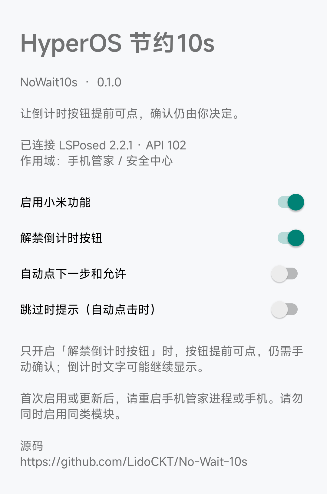

# HyperOS Save 10s (NoWait10s)

Makes the countdown confirmation buttons in Xiaomi Security Center clickable immediately, leaving the final decision to confirm up to the user.
Built with modern libxposed API 102, with a scope limited to Security / Security Center (`com.miui.securitycenter`).

## Features and Default Settings

| Feature | Default | Description |
| --- | --- | --- |
| Enable Xiaomi Features | On | Master switch |
| Unlock Countdown Button | On | Makes matched confirmation buttons clickable immediately without automatically confirming |
| Auto-Click Next & Allow | Off | Automatically clicks matched confirmation buttons |
| Notification on Skip | Off | Shows a notification when an auto-click succeeds |

After unlocking, the countdown text may still be displayed. A clickable button does not mean permission has already been granted.
It is recommended to keep auto-click disabled during initial use.

## How to Use

1. Install a framework that supports libxposed API 102, then install this module.
2. Enable this module in LSPosed and select Security / Security Center as the scope.
3. Open the module settings and confirm that the service is connected successfully and feature switches are set properly.
4. After enabling for the first time, updating, or switching between similar modules, restart the target process or reboot the device.
5. Using similar modules (such as the original BetterMIUI) at the same time may cause duplicate hooks; please enable only one during testing.

## Compatibility

Tested and verified on Redmi K40 (HyperOS EU 1.0.10.0) and Redmi Note 12 Turbo (HyperOS EU 3.0.5.0).

- Frameworks that only provide the legacy Xposed API are not supported.

## Credits and Acknowledgments

Based on the functional behavior and APK analysis of BetterMIUI 1.5 (`com.mikutart.bettermiui`), this project reimplements the Xiaomi countdown feature along with a modern API configuration pipeline.
This is neither an official sequel released by the original author nor source code recovered from the original project.
The original version also included ColorOS features; this project only migrates the Xiaomi portion.
Thanks to the original author for the feature design, and to the libxposed project.

## Source Code

Source code: https://github.com/LidoCKT/No-Wait-10s

## Interface

Click the screenshot to view the full-size image.

## License

The code for this project is licensed under BSD-3-Clause; see [LICENSE](https://github.com/LidoCKT/No-Wait-10s/blob/main/LICENSE) for details.
The libxposed dependency is distributed under its Apache-2.0 license; see `THIRD_PARTY_NOTICES.md` in the repository for details.

## Building

See [BUILDING.md](BUILDING.md).
